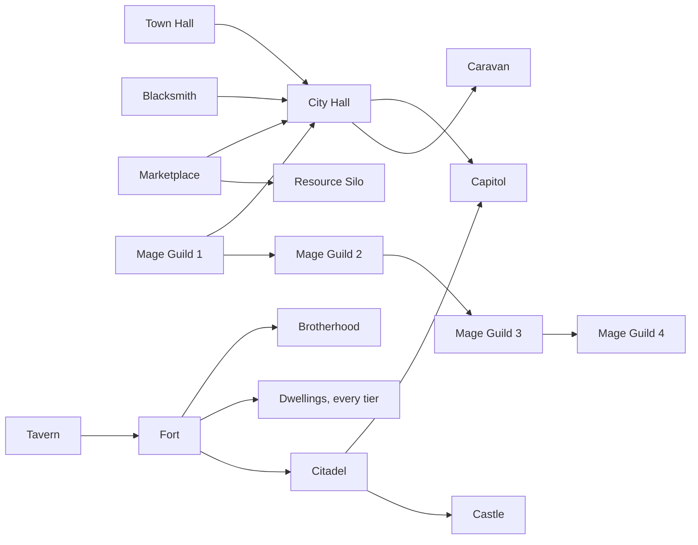

# Town buildings and tech tree

Every town building, what it costs, what it needs and what it does, and the creature dwellings of each playable town.
Rules: ADR-030 (7 of 9 dwellings), ADR-046 (building list), ADR-050 (towns in play), ADR-054 (caravan, map
dwellings), ADR-056 (blacksmith), ADR-060 (tavern), ADR-063 (governors and Stewardship). All towns share one building list for now; their dwellings come from their creature lines. Numbers are a draft.

Sources: `src/Godot/EternalWars.Godot.Assets/data/buildings.csv` (columns in
[development.md](../technical/development.md#editing-town-buildings)) and `creatures.csv`. Update the tables on this page when
those files change.

Status: ✅ works in play · ⏳ built and paid for, effect waits for a feature · ❓ not decided yet.

## Town rules

- **One building per town per day**, on the owner's turn, if its requirements are built and the owner can pay
  (`BuildCommand`, `BuildDwellingCommand`). Higher levels need the level below.
- **New towns** start with **Town Hall, Fort and Tavern** (level 1), also when a map does not list buildings. The editor
  can pre-build more, but keeps the requirements.
- **Nothing is demolished.** Choices are final per town; another town of the same type may choose differently.
- **Income**: an owned town pays every day the income of the highest level of each building.
- **Town turn**: build, recruit into the garrison or the visiting hero, upgrade stacks for the price difference, move
  stacks between the garrison (7 slots) and the visiting hero (an own hero on the entrance).
- **Governor** (ADR-063): a hero with Stewardship can govern one own town (appointed, or by itself when it visits a town
  without one). Only a governed town gets the discount, at the governor's level: buildings **5 / 10 / 15 %** cheaper,
  creatures **10 / 15 / 20 %** (recruiting and upgrading; rounded up per resource; `StewardshipRules`).

## Buildings

| Id | Level | Name | Cost | Requires | Income a day |
|---|---|---|---|---|---|
| `town-hall` | 1 | Town Hall | 2 500 gold, lumber 5, ore 5 | – | gold 500 |
| `town-hall` | 2 | City Hall | 5 000 gold, lumber 10, ore 10 | blacksmith 1, marketplace 1, mage-guild 1 | gold 1000 |
| `town-hall` | 3 | Capitol | 10 000 gold, lumber 20, ore 20 | fort 2 | gold 2000 |
| `fort` | 1 | Fort | 1 500 gold, lumber 5, ore 5 | tavern 1 | – |
| `fort` | 2 | Citadel | 3 000 gold, lumber 10, ore 10 | – | – |
| `fort` | 3 | Castle | 6 000 gold, lumber 15, ore 15 | – | – |
| `blacksmith` | 1 | Blacksmith | 1 000 gold, lumber 5, ore 5 | – | – |
| `marketplace` | 1 | Marketplace | 1 250 gold, lumber 5 | – | – |
| `marketplace` | 2 | Resource Silo | 2 500 gold, lumber 5, ore 5 | – | lumber 1, ore 1 |
| `mage-guild` | 1 | Mage Guild | 2 000 gold, lumber 5, mercury 2 | – | – |
| `mage-guild` | 2 | Mage Guild 2 | 3 500 gold, crystal 3, mercury 3 | – | – |
| `mage-guild` | 3 | Mage Guild 3 | 5 000 gold, crystal 5, sulfur 5 | – | – |
| `mage-guild` | 4 | Mage Guild 4 | 7 500 gold, crystal 7, mercury 7, sulfur 7 | – | – |
| `caravan` | 1 | Caravan | 1 000 gold, lumber 5 | town-hall 2 | – |
| `tavern` | 1 | Tavern | 750 gold, lumber 5 | – | – |
| `tavern` | 2 | Brotherhood | 2 000 gold, lumber 5, ore 5 | fort 1 | – |

| Building | Effect | Status |
|---|---|---|
| Town Hall | gold income: 500 / 1000 / 2000 a day | ✅ |
| Fort | Fort: needed for every dwelling; Citadel: town dwellings grow +50 % (bonus rounded down); Castle: +100 % (`TownRules.WeeklyGrowth`). Sieges: Fort = town wall and gate, Citadel adds a keep, Castle towers and stronger walls (ADR-066) | ✅ dwellings, growth; ⏳ fortifications (sieges post-1.0) |
| Blacksmith | sells the healing tent, the ammo cart and a lost offensive machine to the visiting hero (ADR-056) | ✅ |
| Marketplace | level 2 (Resource Silo): +1 lumber, +1 ore a day; trading resources | ✅ silo; ⏳ trading ❓ |
| Mage Guild | spells of its level (ADR-047); level 4 is a placeholder | ⏳ magic (Phase 5) |
| Tavern | hire 2 heroes (1 native + 1 adjacent); Brotherhood: 4 heroes (2 native, 1 adjacent, 1 of the rest). Stronghold and Swamp Bestiary (no ring): 1 native + 1 warrior of another town; Brotherhood 2 native + 2 warriors (`TavernRules.Slots`). 2500 gold each (ADR-060) | ✅ |
| Caravan | hire creatures from owned map dwellings; move troops between towns (ADR-054); cost and requirement are placeholders | ✅ |

## Tech tree

Arrows point from a requirement to what it unlocks. Each level also needs the level below it.

Since every town starts with Town Hall, Fort and Tavern, the shortest way to the Capitol is Blacksmith, Marketplace and
Mage Guild 1 (City Hall), then Citadel, then Capitol: six days and 22 250 gold, 55 lumber, 45 ore and 2 mercury
(the six buildings' costs added up). Every dwelling needs the Fort (`fort 1` on the `dwelling-*` level-1 rows, ADR-066);
new towns have it, so this only matters for towns a map places without a fort.

## Dwellings

Each playable town has **nine creature lines**: two alternatives at each of tiers 1–4 and one at tier 5, all
upgradeable.

- A town builds **at most 7 of its 9 dwellings**, with **at least one per tier** (ADR-030). A build that would leave a
  tier with no room is refused: with 6 built and tier 3 still empty, only a tier 3 dwelling may be built. So every
  town ends with the tier 5 dwelling, both lines at two tiers and one line at the other two. The two unbuilt lines
  are locked in that town.
- A dwelling's **level 2 is its upgrade**: it sells both the base and the upgraded creature from the same pool, and
  stacks of that line can be upgraded in the town for the price difference.
- **Dwellings need the Fort** (ADR-066), in play and in the editor.
- **Growth**: a new dwelling opens with one week of creatures; every Monday each built dwelling adds its creature's
  weekly growth, owned or not, and unbought creatures accumulate. The upgrade does not raise growth. The fort raises
  the growth of the town's dwellings (opening week included): **Citadel +50 %, Castle +100 %**, the bonus rounded down
  (growth 1 stays 1 with a Citadel, 2 with a Castle; ADR-066). Map dwellings never get it. The growth numbers in the
  tables below are the base growth.
- Locked-out creatures can still be found in other towns of the same type and in map dwellings (ADR-054).

Every dwelling of a tier costs the same (the `dwelling-1` … `dwelling-5` rows):

| Tier | Build | Upgrade |
|---|---|---|
| 1 | 500 gold | 1 000 gold |
| 2 | 1 000 gold, lumber 2 | 2 000 gold, lumber 4 |
| 3 | 1 500 gold, lumber 3, ore 3 | 3 000 gold, lumber 6, ore 6 |
| 4 | 2 000 gold, lumber 4, ore 4, mercury 1 | 4 000 gold, lumber 8, ore 8, mercury 2 |
| 5 | 2 500 gold, lumber 5, ore 5, mercury 1, crystal 1 | 5 000 gold, lumber 10, ore 10, mercury 2, crystal 2 |

Creature prices below are per creature; full stats are in `creatures.csv`.

### Haven

| Tier | Creature (growth a week, price) | Upgrade (price) |
|---|---|---|
| 1 | Footman (18, 55 gold) | Crusader (70 gold) |
| 1 | Pikeman (16, 60 gold) | Guardian (80 gold) |
| 2 | Zealot (9, 185 gold) | Inquisitor (240 gold) |
| 2 | Archer (10, 165 gold) | Marksman (210 gold) |
| 3 | Monk (5, 450 gold) | Priest (580 gold) |
| 3 | Griffin (5, 450 gold) | Royal Griffin (580 gold) |
| 4 | Lancer (3, 1 100 gold) | Champion (1 450 gold) |
| 4 | Paladin (3, 1 100 gold) | Sacred Warrior (1 450 gold) |
| 5 | Radiant Spirit (1, 3 300 gold, crystal 1) | Seraph (4 300 gold, crystal 2) |

### Sylvan

| Tier | Creature (growth a week, price) | Upgrade (price) |
|---|---|---|
| 1 | Pixie (20, 50 gold) | Sprite (65 gold) |
| 1 | Satyr (16, 60 gold) | Satyr Warrior (80 gold) |
| 2 | Blade Dancer (8, 210 gold) | War Dancer (270 gold) |
| 2 | Hunter (9, 185 gold) | Arcane Archer (240 gold) |
| 3 | Druid (5, 450 gold) | Druid Elder (580 gold) |
| 3 | Pegasus (5, 450 gold) | Silver Pegasus (580 gold) |
| 4 | Qilin (3, 1 100 gold) | Pristine Unicorn (1 450 gold) |
| 4 | Treant (2, 1 650 gold) | Ancient Treant (2 150 gold) |
| 5 | Fire Bird (1, 3 300 gold, mercury 1) | Phoenix (4 300 gold, mercury 2) |

### Academy

| Tier | Creature (growth a week, price) | Upgrade (price) |
|---|---|---|
| 1 | Gremlin (20, 50 gold) | Gremlin Master (65 gold) |
| 1 | Defender (15, 65 gold) | Shield Guard (85 gold) |
| 2 | Gargoyle (9, 185 gold) | Obsidian Gargoyle (240 gold) |
| 2 | Iron Golem (7, 240 gold) | Animated Armor (310 gold) |
| 3 | Snow Maiden (5, 450 gold) | Enchantress (580 gold) |
| 3 | Sorcerer (5, 450 gold) | Mage (580 gold) |
| 4 | Djinn (3, 1 100 gold) | Djinn Sultan (1 450 gold) |
| 4 | Naga (2, 1 650 gold) | Naga Queen (2 150 gold) |
| 5 | Colossus (1, 3 300 gold, mercury 1) | Titan (4 300 gold, mercury 2) |

### Necropolis

| Tier | Creature (growth a week, price) | Upgrade (price) |
|---|---|---|
| 1 | Skeleton (20, 50 gold) | Skeleton Warrior (65 gold) |
| 1 | Plague Bearer (15, 65 gold) | Flesh Golem (85 gold) |
| 2 | Ghoul (9, 185 gold) | Alghoul (240 gold) |
| 2 | Death Weaver (8, 210 gold) | Fate Weaver (270 gold) |
| 3 | Vampire (5, 450 gold) | Vampire Lord (580 gold) |
| 3 | Wight (5, 450 gold) | Wraith (580 gold) |
| 4 | Dark Knight (3, 1 100 gold) | Death Knight (1 450 gold) |
| 4 | Lich (3, 1 100 gold) | Arch Lich (1 450 gold) |
| 5 | Bone Dragon (1, 3 300 gold, mercury 1) | Ghost Dragon (4 300 gold, mercury 2) |

### Inferno

| Tier | Creature (growth a week, price) | Upgrade (price) |
|---|---|---|
| 1 | Imp (20, 50 gold) | Familiar (65 gold) |
| 1 | Horned Demon (15, 65 gold) | Horned Overseer (85 gold) |
| 2 | Hell Hound (8, 210 gold) | Cerberus (270 gold) |
| 2 | Tormentor (9, 185 gold) | Lacerator (240 gold) |
| 3 | Succubus (5, 450 gold) | Succubus Mistress (580 gold) |
| 3 | Hell Charger (5, 450 gold) | Nightmare (580 gold) |
| 4 | Pit Fiend (3, 1 100 gold) | Pit Lord (1 450 gold) |
| 4 | Juggernaut (2, 1 650 gold) | Ravager (2 150 gold) |
| 5 | Devil (1, 3 300 gold, mercury 1) | Arch Devil (4 300 gold, mercury 2) |

### Dungeon

| Tier | Creature (growth a week, price) | Upgrade (price) |
|---|---|---|
| 1 | Troglodyte (18, 55 gold) | Deep Troglodyte (70 gold) |
| 1 | Scout (15, 65 gold) | Stalker (85 gold) |
| 2 | Medusa (8, 210 gold) | Putrid Medusa (270 gold) |
| 2 | Minotaur (7, 240 gold) | Minotaur Guard (310 gold) |
| 3 | Dark Raider (5, 450 gold) | Grim Raider (580 gold) |
| 3 | Shadow Mistress (5, 450 gold) | Shadow Matriarch (580 gold) |
| 4 | Manticore (3, 1 100 gold) | Scorpicore (1 450 gold) |
| 4 | Spectator (3, 1 100 gold) | Beholder (1 450 gold) |
| 5 | Shadow Horror (1, 3 300 gold, sulfur 1) | Shadow Reaper (4 300 gold, sulfur 2) |

### Stronghold

| Tier | Creature (growth a week, price) | Upgrade (price) |
|---|---|---|
| 1 | Goblin (22, 45 gold) | Hobgoblin (60 gold) |
| 1 | Harpy (14, 70 gold) | Fury (90 gold) |
| 2 | Orc (9, 185 gold) | Orc Berserker (240 gold) |
| 2 | Centaur (8, 210 gold) | Centaur Warchief (270 gold) |
| 3 | Ogre (5, 450 gold) | Ogre Mage (580 gold) |
| 3 | Wolf Rider (5, 450 gold) | Wolf Raider (580 gold) |
| 4 | Roc (5, 660 gold) | Thunderbird (860 gold) |
| 4 | Cyclops (3, 1 100 gold) | Cyclops King (1 450 gold) |
| 5 | Behemoth (1, 3 300 gold, crystal 1) | Ancient Behemoth (4 300 gold, crystal 2) |

### Swamp Bestiary

| Tier | Creature (growth a week, price) | Upgrade (price) |
|---|---|---|
| 1 | Lizardman (16, 60 gold) | Lizard Warrior (80 gold) |
| 1 | Kappa (15, 65 gold) | Kappa Shaman (85 gold) |
| 2 | Jungle Horror (7, 240 gold) | Jungle Terror (310 gold) |
| 2 | Mantis (9, 185 gold) | Dragon Mantis (240 gold) |
| 3 | Basilisk (5, 450 gold) | Greater Basilisk (580 gold) |
| 3 | Owlbear (5, 450 gold) | Elder Owlbear (580 gold) |
| 4 | Gorgon (3, 1 100 gold) | Mighty Gorgon (1 450 gold) |
| 4 | Haspid (3, 1 100 gold) | Royal Haspid (1 450 gold) |
| 5 | Hydra (1, 3 300 gold, sulfur 1) | Chaos Hydra (4 300 gold, sulfur 2) |

## Open

- Marketplace trading and the mage guild ([TOWN-3](../project/open-questions.md#towns-and-economy)). The fort's
  fortifications only take effect with sieges (post-1.0, ADR-066).
- The caravan's cost and place in the tree (ADR-054): placeholders, tune after play-testing.
- Per-town buildings: all towns share one list for now.
